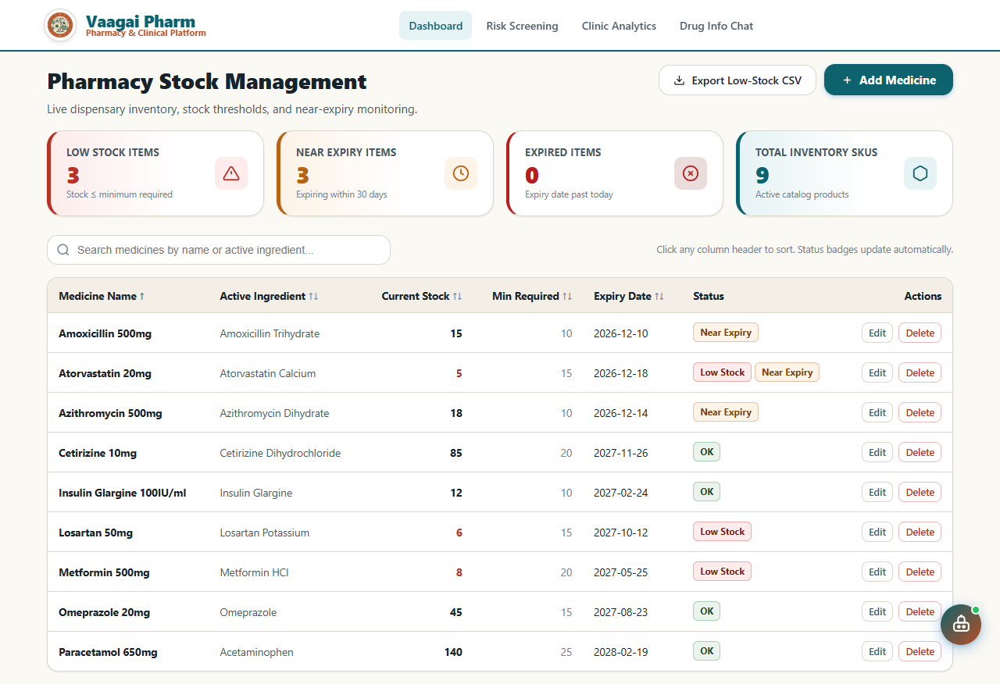
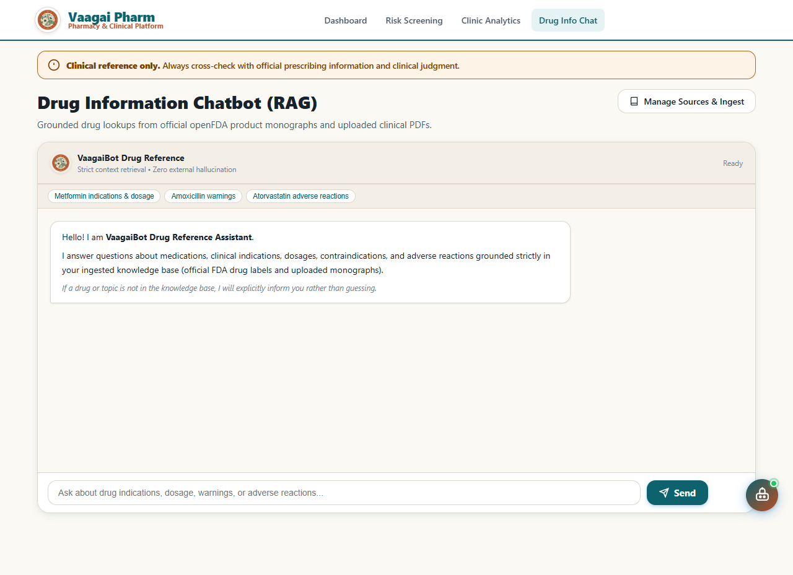
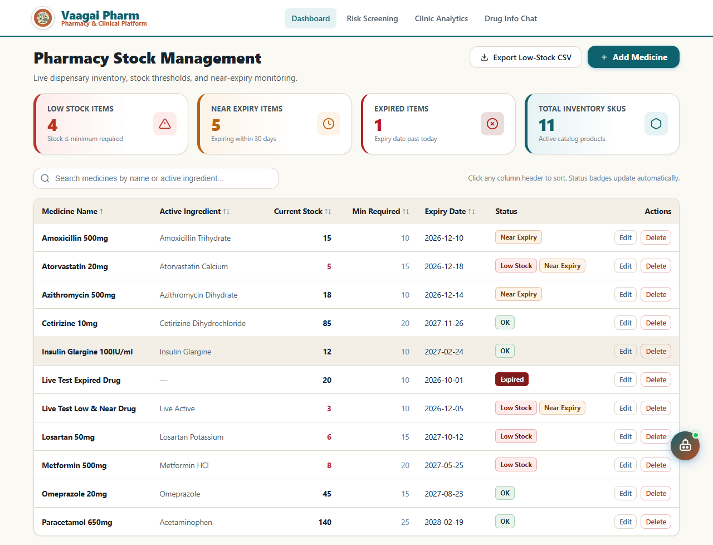
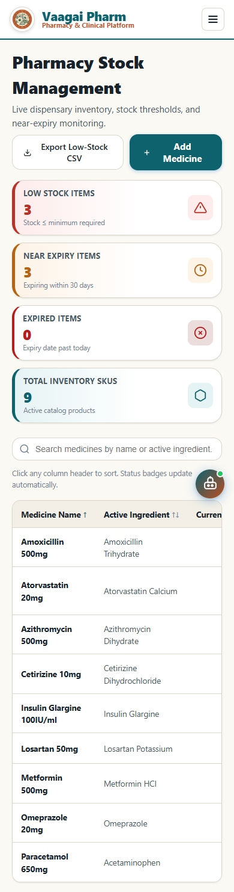

# Vaagai Pharm - Pharmacy & Clinical Intelligence Platform

> **Vaagai** (meaning *"victory tree / banyan"* in Tamil) symbolizes enduring strength, resilience, and holistic healing. **Vaagai Pharm** combines community pharmacy stock management, retrieval-augmented drug intelligence (RAG), and preventive clinical risk screening into a unified, privacy-first platform.

---

## Visual Tour

| Pharmacy Dashboard (Desktop 1280px) | Drug Information RAG (Desktop 1280px) |
| :---: | :---: |
|  |  |

| Stock Alert Badges & Low Stock Table | Responsive Mobile View (390px) |
| :---: | :---: |
|  |  |

---

## One-Minute Quick Start

> **Note on Folder Name:** If your local directory name contains a space (such as `"Vaagai- Pharm"`), always enclose the path in quotes when navigating in the terminal (`cd "Vaagai- Pharm"`).

### Option A: One-Click Launch Script
- **Windows:** Double-click or run:
  ```cmd
  start.bat
  ```
  *(Automatically creates `venv` if missing, installs dependencies, launches the server, and opens your default browser at `http://127.0.0.1:5000`)*.
- **Linux / macOS:** Run:
  ```bash
  chmod +x start.sh
  ./start.sh
  ```

### Option B: Manual Setup
```bash
# 1. Create and activate a Python 3.10+ virtual environment
python -m venv venv

# Windows
venv\Scripts\activate
# Linux / macOS
source venv/bin/activate

# 2. Install production dependencies
pip install -r requirements.txt

# 3. (Optional) Configure environment variables
copy .env.example .env    # Windows
# cp .env.example .env    # Linux / macOS

# 4. Start the application
python app.py
```
Open **`http://127.0.0.1:5000`** in your browser. The app defaults immediately to the `#dashboard` Pharmacy Stock Management view.

---

## Try It: Sample Drug Chatbot Questions

Test the retrieval-augmented drug chatbot (`#drug-chat`) with these 5 clinical queries:

| # | Question to Ask | Expected Behavior & Response |
|---|---|---|
| **1** | *"What is Metformin used for?"* | Retrieves the **Indications and Usage** section for Metformin Hydrochloride (Type 2 diabetes glycemic control). Source title is cited and clickable. |
| **2** | *"What is the dosage of Amoxicillin?"* | Retrieves the **Dosage and Administration** section for Amoxicillin, prepended/appended with the mandatory warning: *"Dosage information must be verified by a pharmacist before dispensing."* |
| **3** | *"What is the generic alternative for Lipitor?"* | Matches brand name **Lipitor** to **Atorvastatin Calcium** via the dedicated `Generic Name and Class` chunk, citing its HMG-CoA reductase inhibitor class. |
| **4** | *"What are the warnings and adverse reactions for Metformin?"* | Boosts and retrieves the **Warnings and Precautions** chunk (lactic acidosis warnings). |
| **5** | *"What is the dosage of Aspirin?"* *(or "What is the capital of France?")* | **Guardrail Triggered:** Neither Aspirin nor off-topic queries exist in the local monographs. Bot refuses to guess from general knowledge and returns: *"I could not find information about that in the Vaagai Pharm drug knowledge base. Please check the drug name or ingest its monograph."* with empty sources (`[]`). |

---

## Architecture & Project Structure

```
Vaagai- Pharm/
├── app.py                      # Unified Flask web backend and REST API
├── requirements.txt            # Production dependencies
├── requirements-dev.txt        # Development dependencies (pytest, playwright)
├── .env.example                # Example environment configuration
├── LICENSE                     # MIT License
├── README.md                   # Project documentation
├── start.bat                   # 1-click start script for Windows
├── start.sh                    # 1-click start script for Linux / macOS
│
├── docs/
│   └── screenshots/            # Verified visual assets (< 1 MB total)
│       ├── 01_dashboard_1280px.png
│       ├── 02_dashboard_390px.png
│       ├── 05_drug_chat_1280px.png
│       └── 08_inventory_badges_1280px.png
│
├── ml/                         # Clinical ML models & training references
│   ├── model.joblib            # Trained Random Forest classifier
│   ├── metrics.json            # Model evaluation metrics
│   ├── train_model.py          # Model training pipeline
│   └── data/
│       └── diabetes.csv        # Pima Indians diabetes study reference
│
├── templates/
│   └── index.html              # Responsive single-page application (4 primary tabs)
│
├── static/
│   └── logo.png                # Brand logo asset
│
└── tests/                      # Automated test suite
    ├── test_api.py             # 21 comprehensive pytest integration tests
    └── e2e/
        └── test_browser_e2e.py # End-to-end Playwright browser test suite
```

---

## Core Capabilities

### 1. Pharmacy Stock Management Dashboard (`#dashboard`)
- **Real-Time Inventory Tracking:** Stock levels, active ingredients, minimum required quantities, and batch expiration dates.
- **Rule-Based Stock Alert Badges:**
  - `Low Stock` (red): Current stock &le; minimum required threshold.
  - `Near Expiry` (amber): Expiry date &le; today + 30 days.
  - `Expired` (dark red): Expiry date &lt; today.
  - `OK` (neutral green): Healthy stock and valid expiry.
- **Summary Banner:** Live counts for Total SKUs, Low Stock Items, Near Expiry Items, and Expired Items.
- **Dynamic Sorting & Instant Filtering:** Search-as-you-type filter by medicine name or active ingredient; sortable columns (numeric sorting: 9 before 10).
- **Inventory CRUD:** Add, update, and delete medicines with input validation (rejection of negative stock, YYYY-MM-DD date validation, and 404 handling).
- **Low-Stock CSV Export:** One-click generation and download of low-stock items with suggested reorder quantities:
  $$\text{Suggested Reorder Qty} = \max(0, \text{minimum\_required\_stock} - \text{current\_stock})$$

### 2. Drug Information Chatbot — RAG (`#drug-chat`)
- **Query-Intent Routing & Drug Matching:** Pure-Python lexical RAG with intent routing mapping clinical question keywords to FDA section headings:
  - `"used for / indicated / treat / what is"` &rarr; `Indications and Usage`
  - `"dose / dosage / how much / how often / maximum"` &rarr; `Dosage and Administration`
  - `"warning / precaution / side effect / adverse"` &rarr; `Warnings and Precautions` / `Adverse Reactions`
  - `"contraindicated / who should not / avoid"` &rarr; `Contraindications`
  - `"generic / alternative / substitute / brand / same as"` &rarr; `Generic Name and Class`
- **Drug-Entity Relevance Boosting:** Chunks mentioning the specific drug queried are prioritized so the target drug always outranks cross-drug section matches.
- **Dynamic Ingestion Awareness:** Catalog and generic/brand names are indexed dynamically at query time from SQLite, immediately recognizing newly ingested monographs without server restart.
- **Anti-Hallucination Guardrails:** If no relevant chunk matches above the threshold (or an unindexed drug / off-topic question is queried), VaagaiBot explicitly reports that the drug or query is not present in the ingested knowledge base, refusing to guess from general knowledge.
- **Mandatory Dosage Warning:** Any query or retrieved chunk concerning medication dosage automatically includes: *"Dosage information must be verified by a pharmacist before dispensing."*
- **Offline Fallback with Multi-Chunk Retrieval:** When Groq is not configured, returns the top 2 relevant chunks (same drug preferred), each labeled with its source document title and pharmacist verification guidance.
- **Source Management & Ingestion:**
  - One-click ingestion from the official **US openFDA API** storing: `indications_and_usage`, `dosage_and_administration`, `warnings`, `contraindications`, `adverse_reactions`, and dedicated `Generic Name and Class` (generic name, brand names, and pharmacologic class).
  - **Duplicate Refresh Handling:** Re-fetching an existing openFDA record automatically replaces previous chunks and returns `"refreshed": true`.
  - **Section Capping:** Sections are capped to prevent oversized labels from creating excessive chunks.
  - **Secure PDF Monograph Upload:** Multipart PDF upload with automated text extraction (`pypdf`), chunking, and embedding. Enforces a strict 10 MB file size limit and `%PDF` file header verification.

### 3. Diabetes Risk Screening (`#test`)
- **2-Minute Clinical Risk Wizard:** Evaluates routine metrics (glucose, BMI, blood pressure, age, pregnancies, pedigree) using a Random Forest classifier.
- **Attributable Factor Analysis:** What-if counterfactual explanations identifying personalized lifestyle targets.
- **Downloadable & Printable Clinical Reports:** Plain-language guidance with local storage and instant report sheet printing.

### 4. Clinic Analytics Dashboard (`#clinics`)
- **Cohort Performance:** In-depth evaluation metrics (Recall, Specificity, Brier Score, ROC-AUC) on the reference study.
- **Live Local Audit Log:** Anonymous log of recent screenings performed on the device.

---

## API Endpoints

### Pharmacy Stock (`/api/inventory`)
- `GET /api/inventory` — List all medicines with computed `is_low_stock`, `is_near_expiry`, and `is_expired` flags, plus summary counts including `expired_count`.
- `POST /api/inventory` — Add a new medicine item (validates non-negative stock and ISO YYYY-MM-DD expiry date).
- `PUT /api/inventory/<id>` — Update an existing medicine item (returns 404 if not found).
- `DELETE /api/inventory/<id>` — Delete a medicine item (returns 404 if not found).
- `GET /api/inventory/export-low-stock` — Download CSV of low-stock items.

### Drug Information RAG (`/api/drug-*`)
- `POST /api/drug-chat` — RAG Q&A endpoint taking `{ question }` and returning `{ answer, sources }`.
- `GET /api/drug-documents` — List all ingested documents with chunk counts.
- `POST /api/drug-documents/fetch-openfda` — Fetch and ingest drug label from openFDA API with duplicate refresh.
- `POST /api/drug-documents/upload` — Ingest uploaded clinical PDF (maximum 10 MB, %PDF header validated).
- `DELETE /api/drug-documents/<id>` — Remove a document and its chunks (returns 404 if not found).

### Clinical Risk & Chat
- `POST /api/predict` — Diabetes risk prediction with counterfactual explanations.
- `GET /api/dashboard` — Clinic analytics cohort statistics.
- `POST /api/chat` — VaagaiBot conversational diabetes guidance.

---

## Security, Authentication & Deployment

- **No Multi-User Accounts / Trusted Network Scope:** The application does not implement individual user logins, password hashing, or multi-tenant roles. It is intentionally designed as an offline-first or single-operator appliance for local clinics or community pharmacies. **It should only be run on localhost or within a secure, trusted private local network (VPN / VLAN).**
- **Optional Admin Key Gate (`VAAGAI_ADMIN_KEY`):** If the `VAAGAI_ADMIN_KEY` environment variable is defined, write actions (`POST`, `PUT`, `DELETE` on `/api/inventory` and `/api/drug-documents`) require an `X-Admin-Key` header. In the frontend, the key is entered via an in-modal prompt and stored strictly in **`sessionStorage`** (never persisted to `localStorage`, cookies, URLs, or server logs). If `VAAGAI_ADMIN_KEY` is not set, all writes operate openly.
- **GET Endpoints Open:** Read endpoints (`GET /api/inventory`, `GET /api/drug-documents`, `#dashboard`) always remain accessible without authentication.
- **Upload Hardening:** Maximum upload payload limit of 10 MB (`MAX_CONTENT_LENGTH = 10MB`) with JSON 413 response. Uploads accept only `.pdf` files verifying the `%PDF` binary header.
- **Credential Hygiene:** API keys and admin secrets are kept strictly in `.env` (ignored via `.gitignore`) and are never logged or returned over the API.

---

## Limitations

- **Lexical Retrieval Engine:** The drug RAG retrieval engine uses unigram/bigram hashed bag-of-words and deterministic intent routing rather than neural dense embeddings. It relies on keyword overlap and explicit section headings.
- **Knowledge-Bound Answers:** VaagaiBot's drug answers are strictly constrained to documents ingested into the local SQLite database. If a drug or section has not been ingested, the bot will not guess or extrapolate.
- **No Machine Learning in Pharmacy Operations:** No demand forecasting, predictive restocking, or machine learning models are used in the pharmacy stock management features. All inventory warnings, low-stock badges, and reorder quantities are computed via direct threshold comparisons.
- **Clinical Reference Only:** This application is an assistive reference tool for community healthcare education and pharmacy workflow. It is never a substitute for a registered pharmacist's professional judgment or formal medical diagnostics. Diabetes risk screening is not a clinical diagnosis.

---

## Testing & Verification

### 1. Backend Integration Tests (pytest)
```bash
pip install -r requirements-dev.txt
pytest tests -v
```
Runs 21 unit and integration tests covering:
- Stock alert flags (`is_low_stock`, `is_near_expiry`, `is_expired`) and summary counters.
- Low-stock CSV export with formula calculation.
- Input validation (negative stock rejection, invalid date formats, 404 handling).
- Pure-Python RAG retrieval quality, intent routing, and drug entity boosting.
- Dynamic entity recognition for newly ingested drugs without server restart.
- Brand name and generic name matching across ingested monographs.
- Mandatory dosage warnings with and without Groq API keys.
- Unindexed drug guardrails, off-topic handling, and empty question rejection.
- openFDA API ingestion, deduplication refresh (`refreshed: true`), and section capping.
- PDF upload security (extension verification, `%PDF` header check, 10 MB size limit).
- Admin key write gating and unauthorized request rejection.

### 2. End-to-End Browser Tests (Playwright)
```bash
python tests/e2e/test_browser_e2e.py
```
Drives real Chrome to test:
- Zero console errors across all 4 navigation tabs.
- Full inventory CRUD with instant badge and counter updates without page reloads.
- Ascending and descending column sorting (numeric: 9 before 10).
- Real-time medicine name search filtering.
- Client-side low-stock CSV download verification.
- Drug chatbot disclaimer, source citation links, and dosage warnings.
- Manage Sources modal operations (document list, valid PDF upload, delete, error states).
- Mobile layout responsiveness at 390px viewport.
- Complete admin key workflow and strict `sessionStorage`-only security audit.

---

## License

This project is licensed under the [MIT License](LICENSE).
